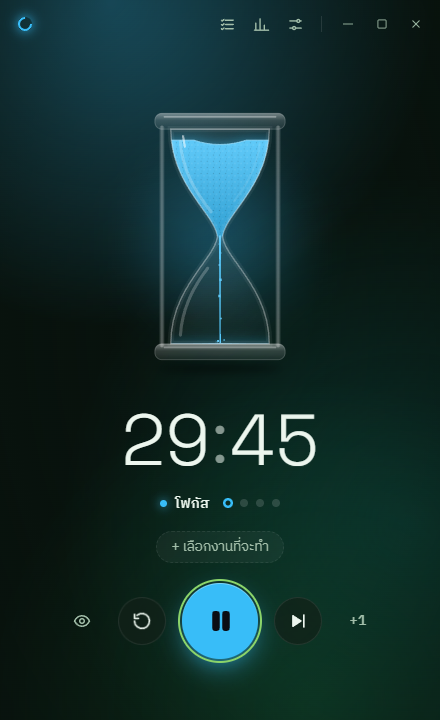

# Focus Flow 🍅

แอปจับเวลา Pomodoro สำหรับ Windows โทนมืด สบายตา ใช้ได้ทั้งภาษาไทยและอังกฤษ

**Pomodoro คืออะไร?** ทำงานแบบโฟกัส 25 นาที แล้วพัก 5 นาที ทำครบ 4 รอบได้พักยาว ช่วยให้ทำงานได้นานโดยไม่ล้า

<p align="center"></p>

## ดาวน์โหลด

1. ไปที่หน้า [**Releases**](../../releases/latest) แล้วโหลดไฟล์ `Focus.Flow.Setup.x.x.x.exe`
2. ดับเบิลคลิกเพื่อติดตั้ง
3. ถ้า Windows ขึ้นจอสีน้ำเงินว่า "Windows protected your PC" ให้กด **More info** → **Run anyway**
   (เพราะแอปไม่ได้ซื้อใบรับรองดิจิทัล ไม่ใช่ไวรัส)

## วิธีใช้

1. เปิดแอป แล้วกด **▶ เริ่ม**
2. ครบเวลา แอปจะเด้งแจ้งเตือนและเปลี่ยนเป็นช่วงพักให้เอง
3. อยากจดว่ากำลังทำงานอะไร ไปแท็บ **Tasks** เพิ่มงานแล้วเลือกเป็นงานปัจจุบัน แอปจะนับรอบให้
4. ดูสรุปว่าวันนี้/สัปดาห์นี้โฟกัสไปเท่าไหร่ ที่แท็บ **Stats**
5. ปรับเวลา ธีม เสียง ภาษา ได้ที่แท็บ **Settings**

กดปิดหน้าต่างแล้วแอปยังทำงานต่อ อยู่ที่ไอคอนมุมขวาล่างของจอ (System tray)

### คีย์ลัด (ใช้ได้แม้อยู่ในโปรแกรมอื่น)

| กด | ทำอะไร |
|---|---|
| `Ctrl` + `Alt` + `P` | เริ่ม / หยุด |
| `Ctrl` + `Alt` + `S` | ข้ามช่วง |
| `Ctrl` + `Alt` + `M` | เปิด / ปิดหน้าต่างจิ๋วที่ลอยอยู่บนจอ |

## ของดีในแอป

- เสียงบรรยากาศช่วยโฟกัส: ฝน คลื่น ลม เตาผิง Brown noise ฯลฯ ผสมกันได้ หรือใส่ไฟล์เสียงของตัวเอง
- ธีม 5 แบบ และเลือกสีของแต่ละช่วงได้เอง
- ข้อมูลเก็บในเครื่องเท่านั้น (`%APPDATA%\Focus Flow\`) ไม่ส่งออกอินเทอร์เน็ต

## สำหรับนักพัฒนา

ต้องมี [Node.js](https://nodejs.org) 20 ขึ้นไป

```
npm install
npm run dev        # รันแบบพัฒนา
npm run build:win  # สร้างไฟล์ติดตั้ง → dist/
```

สร้างด้วย Electron + React + TypeScript

เจอบั๊กหรือมีไอเดีย เปิด [Issues](../../issues) ได้เลย
